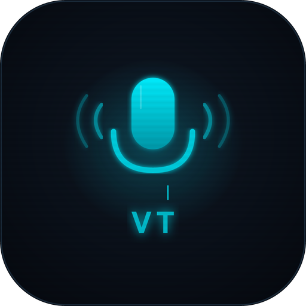

<p align="center">
  
</p>

<h1 align="center">VoiceType</h1>

<p align="center">
  macOS / Windows 桌面應用。語音轉文字，內建離線辨識 + Claude AI 智慧潤稿。
</p>

<p align="center">
  <a href="https://github.com/mark22013333/VoiceType/releases/latest">下載最新版本</a>
</p>

---

## 下載安裝

前往 [Releases](https://github.com/mark22013333/VoiceType/releases/latest) 下載最新版本。

| 平台 | 檔案 |
|------|------|
| macOS (Apple Silicon) | `VoiceType_x.x.x_aarch64.dmg` |
| macOS (Intel) | `VoiceType_x.x.x_x64.dmg` |
| Windows (x64) | `VoiceType_x.x.x_x64-setup.exe` |

### 系統需求

- **macOS 10.15+**（Catalina 以上）或 **Windows 10+**
- [Claude Code CLI](https://docs.anthropic.com/en/docs/claude-code/overview) 已安裝並登入（AI 潤稿功能需要）

### macOS 安裝步驟

1. 下載 `.dmg` 檔案
2. 開啟後將 VoiceType 拖入 Applications 資料夾
3. **首次開啟前，請先執行以下指令**（每次更新後需重新執行一次）

> **macOS 會阻擋未簽名的應用程式**
>
> 由於 VoiceType 尚未取得 Apple 開發者簽名，macOS 會顯示「已損毀，無法打開」的錯誤訊息。
> 這不是檔案損壞，而是 macOS Gatekeeper 安全機制的限制。
>
> **開啟終端機，貼上以下指令即可解決：**
>
> ```bash
> xattr -cr /Applications/VoiceType.app
> ```
>
> 執行後即可正常開啟 VoiceType。**每次更新版本後需要重新執行一次。**

### Windows 安裝步驟

1. 下載 `.exe` 安裝檔
2. 執行安裝程式，依指示完成安裝

---

## 功能特色

### 語音辨識（完全離線）
- 內建 [Whisper](https://github.com/openai/whisper) 語音辨識引擎，所有辨識在本機完成
- 支援多種模型大小（首次使用在設定中下載）
- 即時串流辨識，錄音中即時顯示辨識文字

### AI 智慧潤稿
- 透過 Claude AI 自動將口語轉為書面文字
- 7 種內建模板：純文字整理、會議紀錄、任務清單、郵件草稿、Slack 訊息、正式語氣、輕鬆語氣
- 支援自訂模板，建立專屬的 AI prompt
- 可選擇 Claude 模型（Sonnet / Haiku / Opus）

### 手動輸入潤稿（TYPE 模式）
- 不錄音也能使用 — 直接貼上文字進行 AI 潤稿
- 套用相同的模板和模型設定

### 音訊預處理
- RNNoise 降噪，過濾背景雜音（冷氣、風扇、鍵盤聲）
- 高通濾波預處理，提升辨識準確度

### 桌面整合
- 全域熱鍵一鍵錄音（預設 Cmd+Shift+O，可自訂）
- 常駐工具列，不佔螢幕空間
- 潤稿結果自動複製到剪貼簿
- 錄音檔（.wav）和逐字稿自動存檔

---

## 技術架構

| 元件 | 技術 |
|------|------|
| 桌面框架 | [Tauri v2](https://v2.tauri.app/) (Rust) |
| 前端 | Svelte 5 + Vite |
| 語音辨識 | [whisper.cpp](https://github.com/ggerganov/whisper.cpp) (本機推理) |
| AI 潤稿 | Claude Code CLI |
| 降噪 | RNNoise (nnnoiseless) |
